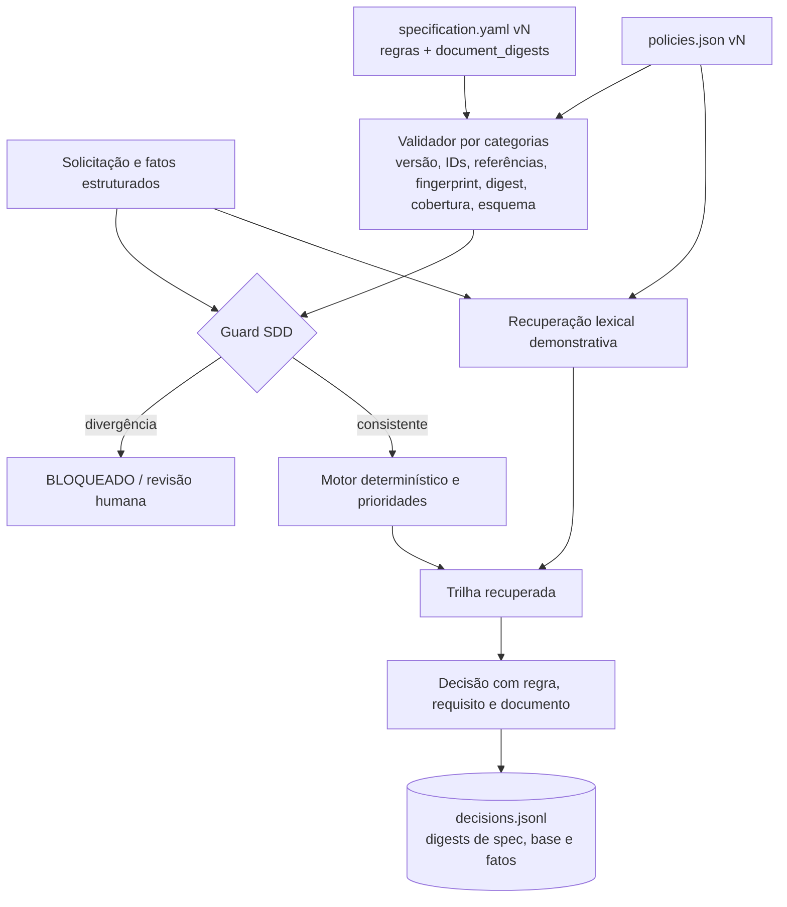

# Arquitetura — EvoPolicy-SDD v0.1.1

**Separação de responsabilidades:**

1. `core.check` / `core.validate`: pré-condição para publicação; devolve problemas por categoria. Os níveis `LEVELS` (L0–L3) são ablações cumulativas. Detecta mudanças estruturais, não mudanças de sentido acompanhadas de recálculo das marcas.
2. `core.PolicyAgent`: aplica regras sobre campos estruturados, em ordem de prioridade, com `default_decision` da especificação. Evita extrair regras por prompt ou regex de linguagem livre.
3. `core.retrieve`: ranqueamento lexical de documentos para demonstrar a interface de recuperação; **não deve ser chamado de RAG completo**.
4. `evolution`: `diff_specs` e `impact` (o que muda entre versões e quais casos são afetados), `trace_matrix`, `synchronize` (recalcula marcas após revisão humana) e `decision_record` (registro JSONL).
5. `experiment.run_benchmark`: cinco condições de demonstração.
6. `mutations.run_mutation_study`: mutantes rotulados × níveis do validador.
7. `project`: localização dos artefatos versionados (fora do pacote instalado).

**Limite da arquitetura atual:** não há LLM, embeddings, memória vetorial, ferramentas remotas nem decisões autônomas financeiras. Esses componentes só serão adicionados com testes e orçamento controlados.

## Estruturas de rastreabilidade

`REQ-05 -> REG-PREMIUM-EXC -> DOC-CANCEL (v2) -> decisão C05`.

O vínculo é verificado nos dois sentidos:

- **documento → regra:** o documento armazena o fingerprint de cada regra que o cita (condições, decisão, prioridade, requisitos, justificativa e documento). Mudou a regra sem atualizar o documento: bloqueio.
- **especificação → documento:** a especificação fixa o digest do texto aprovado de cada documento. Mudou o texto sem revisar a especificação: bloqueio.

Isso é uma garantia **sintática/estrutural**, não uma verificação independente da veracidade do texto. Quem executa `evopolicy fingerprint --write` sem revisar o conteúdo contorna o mecanismo (mutações M10 e M11 do experimento).

## Extensões futuras

- Adaptador retriever com embeddings e índices versionados.
- Adaptador LLM com prompts e saídas validadas por schema, sem autoridade para sobrescrever regras obrigatórias.
- Verificação semântica independente por especialistas e casos adversariais.
- Controle transacional de publicação de especificação + índice + regras.
- Registro de revisão humana, auditoria e replay.
